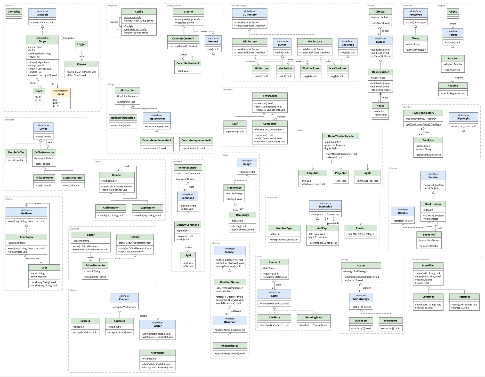

# UML Maker

Type a small text language and get a clean UML class diagram whose automatic layout looks hand-arranged. It works like Mermaid's live editor, but it is built for layout quality.

**Live:** https://uml-maker.vivime.info/



- Editor on the left, live diagram on the right. The diagram re-renders 300 ms after you stop typing.
- Parse errors appear inline with their line number, and the last good diagram stays on screen.
- Pan by dragging or scrolling, zoom with ctrl/⌘ + scroll or pinch, and press **Fit** to frame the diagram.
- Export to **SVG**, **PNG** (3×), **PDF** (page sized to the diagram) or **.drawio** (keeps the computed layout).
- Your text autosaves in the browser. **Share** copies a link with the source compressed into the URL.
- Type **`/`** at the start of a line for a Notion-style insert menu: any of the 23 GoF patterns (`/adapter`, `/insert observer`), every arrow (`/aggregation`, `/realization`…), class blocks and layout directives.

It is a static site with no backend: Vite + TypeScript, [ELK](https://eclipse.dev/elk/) `layered` for layout, hand-written SVG, and CodeMirror 6.

## The language

### Classes

A class is a header followed by its members. A blank line or the next header ends the block. `---` separates attributes (above) from methods (below).

```
class Library
-name: String
-items: List<MediaItem>
---
+Library(name: String)
+render(r: Renderer): void
```

A class without `---` has only attributes, but an empty methods compartment is still drawn:

```
class Point
+x: int
+y: int
```

### Kinds of class

```
abstract class MediaItem   // name in italics
interface Renderer         // «interface» above the name
enum Genre                 // constants, one per line
FICTION
HISTORY
```

### Stereotypes

```
class Shape <<Serializable>>
```

### Members

The first character is the visibility and is shown as written: `+` public, `-` private, `#` protected, `~` package.

```
class Shape
#origin: Point
~packageNote: String
```

`{abstract}` makes a member italic and `{static}` underlines it. Both tags are removed from the displayed text, and either can go anywhere on the line.

```
abstract class MediaItem
---
+render(r: Renderer): void {abstract}
+{static} count(): int
```

### Comments

A line starting with `//`, or with `#` followed by a space, is a comment. `#title` with no space is a protected member, not a comment.

```
// a comment
# also a comment
```

### Relationships

Write one relationship per line, anywhere in the file:

| Syntax | Meaning | Drawn as |
|---|---|---|
| `Film --\|> MediaItem` | inheritance | solid line, hollow triangle at `MediaItem` |
| `HtmlRenderer ..\|> Renderer` | realization | dashed line, hollow triangle |
| `Library *-- MediaItem` | composition | filled diamond at `Library` |
| `Library o-- MediaItem` | aggregation | hollow diamond at `Library` |
| `LibraryApp --> Library` | association | open arrow at `Library` |
| `MediaItem ..> Loan` | dependency | dashed line, open arrow |
| `A -- B` | plain association | line |
| `Library -() Serializable` | provided interface | a lollipop on `Library` |

Reversed forms also work, for example `MediaItem <|-- Film`, `MediaItem --* Library` and `Library <-- LibraryApp`.

An optional `: label` sits at the middle of the edge. Optional `[m] [n]` are the multiplicities at the source and target ends:

```
Library *-- MediaItem : holds [1] [0..*]
LibraryApp --> Library : catalog [1] [0..1]
```

If a relationship names a class that has no block, an empty class box is created for it:

```
Logger ..> Canvas : logs     // Logger is drawn as an empty box
```

A `# comment` (with a space) can follow a relationship on the same line.

### Layout hints

All of these are optional.

```
@direction down          // down (default) or right; parents go above (or left of) children
@spacing compact         // compact | normal (default) | loose
@frames on               // draw a dashed frame around each @group
@group io: Exporter, Renderer, CsvExporter, HtmlRenderer   // keep these together
@same-row CsvExporter, HtmlRenderer                        // put these in one row
```

### Slash commands

Type `/` at the start of a line to open the insert menu, keep typing to filter, and press Enter to insert. `/insert` is optional, so `/insert adapter` and `/adapter` do the same thing.

| Type | Inserts |
|---|---|
| `/adapter`, `/observer`, `/chain`… | that GoF pattern as a ready-made `@group`. If its class names are already used, they get a number suffix (`Adapter2`) so nothing clashes. |
| `/aggregation`, `/inheritance`, `/dependency`… | the relationship line with fill-in fields: type a name, then press Tab to move to the next field |
| `/class`, `/abstract`, `/interface`, `/enum` | an empty class block |
| `/group`, `/same-row`, `/direction`, `/spacing`, `/frames` | the directive |

## How the layout works

- **ELK layered** with orthogonal routing, `NETWORK_SIMPLEX` node placement, `EDGE_LENGTH` post-compaction and `NODES_AND_EDGES` model order, so the order of your source steers the layout.
- **Inheritance and realization edges are reversed for layering**, which puts parents above children. Each parent has one shared `FIXED_SIDE` port, so its children hang from a single trunk as a tree. When a row of siblings would get very wide, the extra siblings drop to a second tier under the same trunk; classes named in `@same-row` stay on the first tier.
- **Box sizes come from measuring the real text** with a hidden canvas in the same font as the SVG, before layout runs.
- **Rows are tidied after layout.** Compaction can stagger siblings vertically, so a pass lines up generalization siblings and `@same-row` sets. Each move is checked geometrically and undone if it would break anything.
- **Edge labels and multiplicities are placed after layout.** Labels are centred on the edge with a white background. Multiplicities sit just outside the box at their end, beside the line, and never overlap a box or another label.
- **Lollipops are not ELK nodes.** ELK reserves room for them as outside node labels, and they are drawn as a 14px circle on a short stub at the class's top right.
- **Components are packed toward 4:3.** Disconnected parts of the diagram, such as each `@group` in the kitchen-sink example, are laid out separately and packed with a skyline packer that aims for a 4:3 bounding box. If the whole diagram still comes out wider than 2:1, it is laid out again in the other direction and the smaller result is kept.

## Development

```bash
npm install
```

```bash
npm run dev
```

```bash
npm test
```

```bash
npm run build && npm run test:e2e
```

`npm test` runs the parser and layout tests, including the check that no edge segment passes through any class box. `test:e2e` serves the build, opens it in headless Chromium with Playwright, checks the same geometry against real font metrics, saves screenshots and all four exports to `e2e/screenshots/`, confirms that a parse error keeps the previous diagram on screen, and drives the slash menu. `node e2e/drawio-check.mjs` renders the exported `.drawio` file with draw.io's own viewer so you can compare it with the app.

Pushing to `main` deploys to GitHub Pages through `.github/workflows/deploy.yml`. In the repository settings, set Pages → Source to "GitHub Actions". The custom domain comes from `public/CNAME`, and the Vite `base` is relative (`./`), so the build also works under `humboldt123.github.io/uml-maker/`.

## Fonts

Source Sans 3 (in `public/fonts/`, used to embed fonts in PDF exports) is under the SIL Open Font License; see `public/fonts/OFL-LICENSE.md`.
